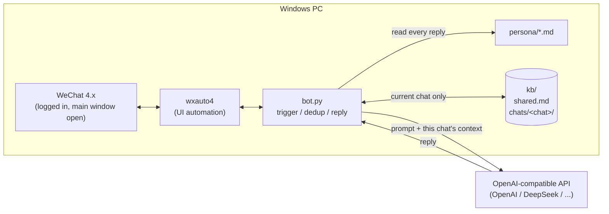

<div align="center">

# wechat-ai-reply-win

**AI auto-reply for WeChat 4.x on Windows: @ it or call its name in a group and it answers. Per-chat isolation, no duplicate replies, persona edits apply instantly.**

English | [简体中文](README.zh-CN.md)

[](LICENSE)
[](https://www.python.org/)
[](#requirements)
[](#requirements)
[](#limitations-and-risks)

</div>

An AI auto-reply bot for personal WeChat that runs on a Windows PC. It uses [wxauto4](https://pypi.org/project/wxauto4/) UI automation to read new messages from a **logged-in WeChat 4.x desktop client** and sends them to any **OpenAI-compatible API** (OpenAI, DeepSeek, ...). In groups it answers when mentioned by name or @, and @-mentions the asker; private chats are optional. Each group or private chat keeps its own context and notes, so nothing leaks between chats. Handled messages are recorded on disk, so restarts never cause duplicate replies. Persona and knowledge are plain text files that apply from the next message. A [legacy engine](alt/wechaty-puppet-xp/) based on Wechaty + puppet-xp is included for reference.

> [!WARNING]
> This is **unofficial** and drives WeChat through UI automation. It **violates WeChat's terms of service and can get your account banned**. Use a secondary account. See [Limitations and risks](#limitations-and-risks).

## Table of contents

- [Features](#features)
- [How it works](#how-it-works)
- [Requirements](#requirements)
- [Quick start](#quick-start)
- [Configuration](#configuration)
- [Persona, knowledge, memory and proactive chat](#persona-knowledge-memory-and-proactive-chat)
- [FAQ](#faq)
- [Limitations and risks](#limitations-and-risks)
- [Legacy engine: Wechaty + puppet-xp](#legacy-engine-wechaty--puppet-xp)
- [Roadmap](#roadmap)
- [Project layout](#project-layout)
- [Credits and license](#credits-and-license)

## Features

| Feature | Details |
| --- | --- |
| Group replies on trigger | Replies when a message contains the bot name/alias or @your WeChat nickname, and @-mentions the asker |
| Private replies (optional) | Off by default; "only when called by name" or "every message" |
| Per-chat isolation | History, notes and memory are stored per chat; prompts only include the current chat |
| Persistent dedup | Handled messages go to `kb/handled.jsonl`; no repeats after a restart |
| Anti-flood | If someone sends several triggers in a row, only the latest is answered |
| Any OpenAI-compatible API | Switch providers with `OPENAI_BASE_URL` + `OPENAI_MODEL` |
| Persona hot-reload | Markdown files in `persona/`, re-read for every reply |
| Knowledge hot-reload | `kb/shared.md` (global facts) and each chat's `knowledge.md`, no restart needed |
| Long-term memory (optional) | After a number of new exchanges, the AI summarizes them into that chat's `memory.md` |
| Proactive chat (experimental) | Listed groups only; says one line when a group goes quiet, with hours, cooldown, daily cap and probability limits |
| Bilingual | One `LANGUAGE` switch for persona and memory prompt language |
| Scrubbed storage | Phone, ID and card numbers and keys are masked before saving |

## How it works



1. Every `POLL_SEC` seconds, read the session list and open chats with new messages.
2. Check new messages for a trigger: `BOT_NAME` / `BOT_ALIASES`, or `@your nickname`.
3. Keep only each sender's latest trigger, then dedup against `kb/handled.jsonl`.
4. Build the prompt: persona + `shared.md` + this chat's `knowledge.md` and `memory.md` + recent exchanges in this chat.
5. Call the AI, keep the first paragraph within the length limit, send it (@-asker in groups), and save the exchange to this chat's folder.

## Requirements

| Item | Requirement |
| --- | --- |
| OS | Windows 10 / 11 x64 with an unlocked desktop session |
| Python | **3.13 x64** (wxauto4 ships Windows wheels for 3.9–3.13) |
| WeChat | **WeChat 4.x for Windows**, logged in, main window open |
| AI | An API key for any OpenAI-compatible API |
| Account | A secondary account is strongly recommended |

## Quick start

1. **Prepare**: install [Python 3.13 x64](https://www.python.org/downloads/) (tick "Add python.exe to PATH") and WeChat 4.x, and log in with a secondary account.
2. **Get the code**: `git clone` or download the ZIP, and extract to a path **without spaces or non-ASCII characters**, e.g. `C:\wechat-ai-reply-win`.
3. **Install**: double-click `install.bat`. It installs dependencies and creates `.env` from `.env.example`.
4. **Configure**: open `.env` in Notepad and fill in at least `OPENAI_API_KEY`, `OPENAI_BASE_URL`, `OPENAI_MODEL`, `BOT_NAME`. For English set `LANGUAGE=en` (default name then becomes Nova if `BOT_NAME` is empty).
5. **Start**: open the WeChat main window, double-click `start.bat`. After `[start]` appears, send a message containing the bot name in a group.

> To test the AI endpoint first, open cmd in the project folder and run `py -3.13 check_config.py --ping`.

## Configuration

Everything lives in `.env`. Every key in [.env.example](.env.example) has English and Chinese comments. Common keys:

| Variable | Default | Meaning |
| --- | --- | --- |
| `LANGUAGE` | `zh-CN` | `zh-CN` or `en`: default persona file and memory prompt language |
| `OPENAI_API_KEY` | (required) | API key |
| `OPENAI_BASE_URL` | `https://api.openai.com/v1` | Compatible endpoint, e.g. `https://api.deepseek.com/v1` |
| `OPENAI_MODEL` | `gpt-4o-mini` | Model name |
| `BOT_NAME` | `小星` (`Nova` for `en`) | Bot name, used in the persona and as a trigger |
| `BOT_ALIASES` | empty | Extra triggers, comma separated |
| `REPLY_IN_GROUPS` / `REPLY_IN_PRIVATE` | `true` / `false` | Reply in groups / private chats |
| `PRIVATE_REQUIRE_TRIGGER` | `true` | Private chats also need the name |
| `CHAT_ALLOWLIST` / `CHAT_BLOCKLIST` | empty | Exact chat names to allow / block |
| `DEDUP_HOURS` | `12` | Dedup window for same sender + same text |
| `MAX_REPLY_CHARS` | `300` | Max reply length |
| `MEMORY_ENABLED` | `true` | Long-term memory summaries |
| `PROACTIVE_ENABLED` | `false` | Proactive chat |

## Persona, knowledge, memory and proactive chat

### Persona

- Default: `persona/persona.zh-CN.md` (`persona.en.md` when `LANGUAGE=en`), or set `PERSONA_FILE`.
- Default style is **plain, direct and short**: answer first, one or two sentences, no flattery, no cutesy tone, no emoji.
- `{{BOT_NAME}}` is replaced with the name from `.env`; `<!-- -->` comments are not sent to the AI.
- **Re-read for every reply**, so no restart is needed.

### Knowledge base (per chat)

```
kb/
├── shared.md                    facts shared by all chats (hand-written)
├── handled.jsonl                dedup records
├── proactive.json               proactive chat state
└── chats/<chat name>/
    ├── chat.jsonl               this chat's exchanges (scrubbed)
    ├── knowledge.md             hand-written notes for this chat only
    ├── memory.md                AI-maintained long-term memory
    └── memory-state.json
```

- A reply only reads `shared.md` and **the current chat's** folder; other chats never enter the prompt.
- `shared.md` and `knowledge.md` are re-read for every reply.
- All data stays on your PC, and `kb/` is git-ignored.

### Long-term memory

With `MEMORY_ENABLED=true`, after every `MEMORY_EVERY_N` new exchanges in a chat, the AI merges them with the existing memory into `memory.md` (names, preferences, topics, plans, facts) and is told not to record sensitive data. You can edit the file any time. The exchanges are sent to your AI provider for this; turn it off if you don't want that.

### Proactive chat (experimental)

Off by default. Set `PROACTIVE_ENABLED=true` and list **exact group names** in `PROACTIVE_CHATS`. Every `PROACTIVE_CHECK_MIN` minutes the bot checks each group and says one line only if all of these hold: inside `PROACTIVE_HOURS`; someone spoke in the last 24 hours; quiet for `PROACTIVE_QUIET_MIN` minutes; at least `PROACTIVE_COOLDOWN_MIN` minutes since its last proactive line and under `PROACTIVE_MAX_PER_DAY` today; and a `PROACTIVE_PROB` roll succeeds. "Quiet" is based only on messages seen while the bot is running.

## FAQ

<details>
<summary><b>start.bat flashes and closes</b></summary>

Type `cmd` in the folder's address bar, press Enter, then run `start.bat` to see the error. Usual causes: Python 3.13 missing, `install.bat` not run, `.env` not filled in.
</details>

<details>
<summary><b>"py" / Python 3.13 not found, or pip install fails</b></summary>

Install Python 3.13 **x64** with "Add python.exe to PATH" ticked, then reopen cmd. wxauto4 only supports Python 3.9–3.13 on Windows; 3.14 and 32-bit Python won't work.
</details>

<details>
<summary><b>WeChat window not found / nothing happens</b></summary>

- WeChat must be logged in with the **main window open**, not minimized to the tray.
- Don't lock the PC; a disconnected Remote Desktop session can also break UI automation.
- A WeChat update can temporarily break wxauto4. Upgrade wxauto4 or hold off updating WeChat.
</details>

<details>
<summary><b>I called it in a group but it didn't reply</b></summary>

- The message must contain `BOT_NAME` / `BOT_ALIASES` or `@your nickname`.
- Check `REPLY_IN_GROUPS=true`, the group isn't in `CHAT_BLOCKLIST`, and names in `CHAT_ALLOWLIST` match exactly.
- The same sender + same text is answered only once within `DEDUP_HOURS`.
- Look for `[ai] retry` in the window or `logs/bot.log` (wrong key or model, or no credit, are the usual causes). Test with `py -3.13 check_config.py --ping`.
</details>

<details>
<summary><b>Replies seem off-topic</b></summary>

Usually someone sent several messages in a row and the replies arrive one after another under the last one. Group replies @-mention the asker, only each sender's latest trigger is answered, and the prompt asks the model to answer only the current message.
</details>

<details>
<summary><b>Can content from group A leak into group B?</b></summary>

Not by design: each reply only reads `shared.md` and the current chat's folder. So **don't** put one group's private content in `shared.md`.
</details>

<details>
<summary><b>Do I need to scan a QR code?</b></summary>

Not in this project. wxauto4 drives the already-logged-in WeChat client; log in to WeChat the normal way.
</details>

## Limitations and risks

- **Against the terms of service; ban risk.** This is not an official WeChat API. It simulates user actions through UI automation and may get the account restricted or banned. Use a secondary account at your own risk.
- **It takes over WeChat on that PC.** The bot switches chat windows on its own; don't use WeChat on that PC while it runs.
- **Unofficial third-party dependency.** wxauto4 is a community project whose author declares no license; this repo only lists it as a dependency and does not redistribute it. WeChat updates can break it.
- **Privacy.** Chat content is stored in `kb/` on your PC and sent to your AI provider. Tell group members, and don't use it in sensitive groups.
- **Windows only.** On Linux/macOS you can only run syntax checks and test the AI endpoint.

See [SECURITY.md](SECURITY.md).

## Legacy engine: Wechaty + puppet-xp

[`alt/wechaty-puppet-xp/`](alt/wechaty-puppet-xp/) is the earlier Node.js + Wechaty + wechaty-puppet-xp 2.1.1 implementation, with BM25-searched group memory and proactive chat.

> [!CAUTION]
> **Legacy / experimental, and largely unusable today.** puppet-xp 2.1.1 only supports WeChat 3.9.10.27, and Tencent now blocks that version at login ("version too old"). Runtime version spoofing (e.g. [FakeWechatVersion](https://github.com/ThinkerWen/FakeWechatVersion)) has reported failures and isn't reliable; paid protocol puppets (iPad / PadLocal) need a paid token and are not official either. This repo ships no version-spoofing code.

See [alt/wechaty-puppet-xp/README.md](alt/wechaty-puppet-xp/README.md).

## Roadmap

- [ ] Measure proactive "quiet time" from the chat's last message time directly
- [ ] In-group commands (e.g. mute the bot in one group)
- [ ] Port BM25 knowledge search from the legacy engine
- [ ] A simple web config page

Issues and PRs are welcome.

## Project layout

```
wechat-ai-reply-win/
├── bot.py               entry: polling, triggers, dedup, replies
├── check_config.py      checks .env and persona; --ping tests the AI API
├── wxbot/
│   ├── config.py        loads .env and the persona
│   ├── ai.py            OpenAI-compatible client
│   ├── kb.py            per-chat knowledge, dedup, long-term memory
│   └── proactive.py     proactive chat
├── persona/             default personas (zh-CN / en)
├── kb/                  local knowledge base (runtime, not committed)
├── .env.example         config template (bilingual comments)
├── requirements.txt
├── install.bat / start.bat
├── alt/wechaty-puppet-xp/   legacy Node engine
└── README.md / README.zh-CN.md / SECURITY.md / LICENSE
```

## Credits and license

- [wxauto4](https://pypi.org/project/wxauto4/) (no license declared by its author; used as a dependency only)
- [Wechaty](https://github.com/wechaty/wechaty), [wechaty-puppet-xp](https://github.com/wechaty/puppet-xp) (Apache-2.0; legacy engine only)

This project's code is released under the [MIT](LICENSE) license and contains no source from the projects above. Follow their licenses and WeChat's terms when using it.
