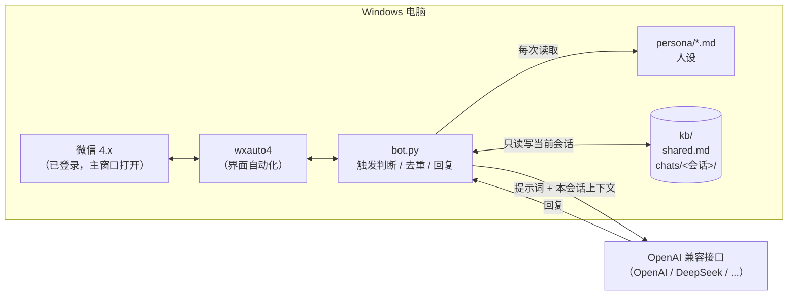

<div align="center">

# wechat-ai-reply-win

**Windows 微信 4.x AI 自动回复：群里 @ 它或叫它名字就回答，会话隔离、不重复回复、人设改完即生效。**

[English](README.md) | 简体中文

[](LICENSE)
[](https://www.python.org/)
[](#环境要求)
[](#环境要求)
[](#限制与风险)

</div>

在 Windows 电脑上运行的微信 AI 自动回复。它用 [wxauto4](https://pypi.org/project/wxauto4/) 通过界面自动化读取**已登录的微信 4.x** 的新消息，交给任意 **OpenAI 兼容接口**（OpenAI、DeepSeek 等）生成回复：群里被 @ 或被叫到名字时回答并 @ 提问的人，私聊可选。每个群/私聊的上下文和知识单独存放，不会串群；已处理的消息落盘去重，重启也不会重复回复；人设和知识库都是普通文本文件，改完下一条消息就生效。另附一个基于 Wechaty + puppet-xp 的[旧版引擎](alt/wechaty-puppet-xp/)，仅供参考。

> [!WARNING]
> 这是**非官方**方案，靠界面自动化操作微信，**违反微信使用条款，有封号风险**，请只用小号。详见 [限制与风险](#限制与风险)。

## 目录

- [功能](#功能)
- [工作原理](#工作原理)
- [环境要求](#环境要求)
- [快速开始](#快速开始)
- [配置说明](#配置说明)
- [人设、知识库、记忆与主动聊天](#人设知识库记忆与主动聊天)
- [常见问题](#常见问题)
- [限制与风险](#限制与风险)
- [旧版引擎：Wechaty + puppet-xp](#旧版引擎wechaty--puppet-xp)
- [路线图](#路线图)
- [项目结构](#项目结构)
- [致谢与许可](#致谢与许可)

## 功能

| 功能 | 说明 |
| --- | --- |
| 群聊触发回复 | 消息包含机器人名字/别名，或 @你的微信昵称 时回复，并 @ 提问的人 |
| 私聊回复（可选） | 默认关闭；可设为“叫名字才回”或“每条都回” |
| 会话隔离 | 每个群/私聊的历史、知识、记忆分开存放，提示词里只放当前会话的内容 |
| 落盘去重 | 处理过的消息写入 `kb/handled.jsonl`，重启后不会重复回复 |
| 防刷屏 | 一个人短时间连发多条触发，只回答最新一条 |
| 任意 OpenAI 兼容接口 | 改 `OPENAI_BASE_URL` + `OPENAI_MODEL` 即可切换服务商 |
| 人设热加载 | `persona/` 下的 Markdown 文件，每次回复都重新读取 |
| 知识库热加载 | `kb/shared.md`（全局事实）和每个会话的 `knowledge.md`，改完不用重启 |
| 长期记忆（可选） | 每个会话新增一定数量问答后，由 AI 整理成该会话的 `memory.md` |
| 主动聊天（实验性） | 只对指定群生效，群里安静时偶尔说一句，有时段、冷却、每日上限、概率限制 |
| 中英双语 | `LANGUAGE` 一个开关切换人设和记忆提示词语言 |
| 存储脱敏 | 写入知识库前遮掉手机号、身份证号、银行卡号和 Key |

## 工作原理



1. 每隔 `POLL_SEC` 秒读取会话列表，找出有新消息的会话并切换过去。
2. 取出新消息，判断是否触发：包含 `BOT_NAME` / `BOT_ALIASES`，或 `@你的微信昵称`。
3. 连发只留每人最新一条，再用 `kb/handled.jsonl` 去重。
4. 拼装提示词：人设 + `shared.md` + 本会话 `knowledge.md` 和 `memory.md` + 本会话最近问答。
5. 调用 AI，回复取第一段并限长；群里 @ 提问的人发出，再把这次问答写入本会话目录。

## 环境要求

| 项目 | 要求 |
| --- | --- |
| 操作系统 | Windows 10 / 11 x64（需要有桌面会话，不能锁屏或最小化到无界面的服务里运行） |
| Python | **3.13 x64**（wxauto4 提供 3.9–3.13 的 Windows 轮子） |
| 微信 | **Windows 版微信 4.x**，已登录，主窗口保持打开 |
| AI | 任意 OpenAI 兼容接口的 API Key |
| 账号 | 强烈建议使用小号 |

## 快速开始

1. **准备环境**：安装 [Python 3.13 x64](https://www.python.org/downloads/)（勾选 “Add python.exe to PATH”）和微信 4.x，用小号登录微信。
2. **下载项目**：`git clone` 或下载 ZIP，解压到**不含中文和空格**的路径，例如 `C:\wechat-ai-reply-win`。
3. **安装依赖**：双击 `install.bat`，它会安装依赖并从 `.env.example` 生成 `.env`。
4. **填写配置**：用记事本打开 `.env`，至少填写 `OPENAI_API_KEY`、`OPENAI_BASE_URL`、`OPENAI_MODEL`、`BOT_NAME`。
5. **启动**：打开微信主窗口，双击 `start.bat`。看到 `[start]` 后，在群里发一句带机器人名字的话试试。

> 想先确认 AI 接口通不通：在项目目录打开 cmd，执行 `py -3.13 check_config.py --ping`。

## 配置说明

所有配置都在 `.env` 里，[.env.example](.env.example) 中每一项都有中英文注释。常用项：

| 变量 | 默认值 | 说明 |
| --- | --- | --- |
| `LANGUAGE` | `zh-CN` | `zh-CN` 或 `en`，决定默认人设文件和记忆提示词语言 |
| `OPENAI_API_KEY` | （必填） | AI 接口的 Key |
| `OPENAI_BASE_URL` | `https://api.openai.com/v1` | 兼容接口地址，如 `https://api.deepseek.com/v1` |
| `OPENAI_MODEL` | `gpt-4o-mini` | 模型名 |
| `BOT_NAME` | `小星` | 机器人名字，写进人设，也是触发词 |
| `BOT_ALIASES` | 空 | 额外触发词，逗号分隔 |
| `REPLY_IN_GROUPS` / `REPLY_IN_PRIVATE` | `true` / `false` | 群聊 / 私聊是否回复 |
| `PRIVATE_REQUIRE_TRIGGER` | `true` | 私聊是否也要叫名字才回 |
| `CHAT_ALLOWLIST` / `CHAT_BLOCKLIST` | 空 | 会话白名单 / 黑名单（完整名称） |
| `DEDUP_HOURS` | `12` | 同一人同一内容的去重窗口 |
| `MAX_REPLY_CHARS` | `300` | 回复最大长度 |
| `MEMORY_ENABLED` | `true` | 长期记忆整理开关 |
| `PROACTIVE_ENABLED` | `false` | 主动聊天开关 |

## 人设、知识库、记忆与主动聊天

### 人设

- 默认人设：`persona/persona.zh-CN.md`（`LANGUAGE=en` 时用 `persona.en.md`），也可以用 `PERSONA_FILE` 指定。
- 默认风格**平实、直接、简短**：先给结论，一两句话，不奉承、不卖萌、不用表情。
- `{{BOT_NAME}}` 会替换成 `.env` 里的名字，`<!-- -->` 注释不会发给 AI。
- **每次回复都重新读取**，改完不用重启。

### 知识库（会话隔离）

```
kb/
├── shared.md                    所有会话共用的固定事实（手写，如官网地址、常见问答）
├── handled.jsonl                去重记录
├── proactive.json               主动聊天状态
└── chats/<会话名>/
    ├── chat.jsonl               本会话问答记录（已脱敏）
    ├── knowledge.md             只属于本会话的手写知识
    ├── memory.md                AI 整理的长期记忆
    └── memory-state.json
```

- 回复某个会话时，只会读取 `shared.md` 和**这个会话自己**的目录，不会把别的群的内容带进提示词。
- `shared.md` 和 `knowledge.md` 每次回复都重新读取，改完立刻生效。
- 所有数据只在你自己的电脑上，`kb/` 已在 `.gitignore` 中。

### 长期记忆

`MEMORY_ENABLED=true` 时，某个会话每新增 `MEMORY_EVERY_N` 条问答，就让 AI 把这些问答和已有记忆合并成 `memory.md`（成员称呼、偏好、话题、约定、事实），并要求不记录敏感信息。你可以随时手动编辑这个文件。整理时问答内容会发送给 AI 服务商，不需要就关掉。

### 主动聊天（实验性）

默认关闭。设置 `PROACTIVE_ENABLED=true`，并在 `PROACTIVE_CHATS` 写上**完整群名**后，机器人每 `PROACTIVE_CHECK_MIN` 分钟检查一次，一个群要同时满足以下条件才会说一句：在 `PROACTIVE_HOURS` 时段内；最近 24 小时有人说过话；已安静 `PROACTIVE_QUIET_MIN` 分钟；距上次主动发言超过 `PROACTIVE_COOLDOWN_MIN` 分钟且当天未达 `PROACTIVE_MAX_PER_DAY` 次；通过 `PROACTIVE_PROB` 概率。“安静多久”只根据机器人运行期间看到的消息计算。

## 常见问题

<details>
<summary><b>双击 start.bat 窗口一闪就关</b></summary>

在项目目录的地址栏输入 `cmd` 回车，再执行 `start.bat`，就能看到报错。常见原因：没装 Python 3.13、没运行 `install.bat`、`.env` 没填。
</details>

<details>
<summary><b>提示找不到 py / Python 3.13 / pip 安装失败</b></summary>

安装 Python 3.13 **x64**，安装时勾选 “Add python.exe to PATH”，装完重新打开 cmd。wxauto4 只支持 Windows 上的 Python 3.9–3.13，3.14 和 32 位 Python 装不上。网络慢可以换镜像：`py -3.13 -m pip install -r requirements.txt -i https://pypi.tuna.tsinghua.edu.cn/simple`。
</details>

<details>
<summary><b>启动报错找不到微信窗口 / 没反应</b></summary>

- 微信要已登录且**主窗口打开**，不要最小化到托盘；
- 电脑不能锁屏，远程桌面断开后界面自动化也可能失效；
- 微信更新后 wxauto4 可能暂时不兼容，可升级 wxauto4 或暂缓更新微信。
</details>

<details>
<summary><b>在群里叫了它但没反应</b></summary>

- 消息里要包含 `BOT_NAME` / `BOT_ALIASES`，或 `@你的微信昵称`；
- 检查 `REPLY_IN_GROUPS=true`，群名不在 `CHAT_BLOCKLIST`，设了 `CHAT_ALLOWLIST` 时群名要完全一致；
- 同一人发同样内容在 `DEDUP_HOURS` 内只回一次；
- 看窗口或 `logs/bot.log` 有没有 `[ai] retry`（Key、模型名错误或余额不足最常见），用 `py -3.13 check_config.py --ping` 单独测接口。
</details>

<details>
<summary><b>回复看起来答非所问</b></summary>

通常是有人连发了几条，回复依次到达，看起来都挂在最后一条下面。本项目群里回复会 @ 提问的人，同一人连发只答最新一条；提示词也要求只回答当前这一条。
</details>

<details>
<summary><b>它会不会把 A 群的内容说到 B 群？</b></summary>

不会主动带入。每次回复只读取 `shared.md` 和当前会话自己的目录；所以**不要**把某个群的私密内容写进 `shared.md`。
</details>

<details>
<summary><b>需要扫码 / 验证码吗？</b></summary>

不需要在本项目里扫码。wxauto4 只是操作已经登录的微信客户端，登录（扫码、手机确认）在微信里正常完成即可。
</details>

## 限制与风险

- **违反使用条款，有封号风险。** 本项目不是微信官方接口，用界面自动化模拟操作，可能导致账号被限制或封禁。请用小号，后果自负。
- **占用这台电脑上的微信。** 机器人会自动切换聊天窗口，运行时不要在这台电脑上手动用微信。
- **依赖第三方非官方组件。** wxauto4 是社区项目，作者未声明许可证；本仓库只把它作为依赖，不分发其代码。微信更新后它可能失效。
- **隐私。** 会话内容保存在本机 `kb/` 并发送给你配置的 AI 服务商。部署前请告知群成员，不要在敏感群里使用。
- **仅 Windows。** 在 Linux/macOS 上只能做语法检查和 AI 接口测试。

更多说明见 [SECURITY.md](SECURITY.md)。

## 旧版引擎：Wechaty + puppet-xp

[`alt/wechaty-puppet-xp/`](alt/wechaty-puppet-xp/) 是早期基于 Node.js + Wechaty + wechaty-puppet-xp 2.1.1 的实现，带 BM25 检索的群记忆和主动聊天。

> [!CAUTION]
> **旧版 / 实验性，目前基本无法使用。** puppet-xp 2.1.1 只支持微信 3.9.10.27，而腾讯已在服务端拦截这个版本登录（提示“当前微信版本过低”）。运行时改版本号的方案（如 [FakeWechatVersion](https://github.com/ThinkerWen/FakeWechatVersion)）已有失败反馈，不可靠；付费协议方案（iPad 协议 / PadLocal 等）需要付费 token，也不是官方接口。本仓库不附带任何改版本号的代码。

使用方法见 [alt/wechaty-puppet-xp/README.md](alt/wechaty-puppet-xp/README.md)。

## 路线图

- [ ] 主动聊天的“安静时长”改为直接读取会话最后消息时间
- [ ] 群内命令（例如让机器人在某个群暂时静音）
- [ ] 知识库检索（BM25）从旧版引擎移植过来
- [ ] 简单的 Web 配置页

欢迎提 Issue 和 PR。

## 项目结构

```
wechat-ai-reply-win/
├── bot.py               入口：轮询、触发判断、去重、回复
├── check_config.py      检查 .env 和人设，--ping 测试 AI 接口
├── wxbot/
│   ├── config.py        读取 .env、加载人设
│   ├── ai.py            OpenAI 兼容接口客户端
│   ├── kb.py            会话隔离的知识库、去重、长期记忆
│   └── proactive.py     主动聊天
├── persona/             默认人设（中文 / 英文）
├── kb/                  本地知识库（运行时生成，不提交）
├── .env.example         配置模板（中英文注释）
├── requirements.txt
├── install.bat / start.bat
├── alt/wechaty-puppet-xp/   旧版 Node 引擎
└── README.md / README.zh-CN.md / SECURITY.md / LICENSE
```

## 致谢与许可

- [wxauto4](https://pypi.org/project/wxauto4/)（作者未声明许可证，仅作为依赖）
- [Wechaty](https://github.com/wechaty/wechaty)、[wechaty-puppet-xp](https://github.com/wechaty/puppet-xp)（Apache-2.0，仅旧版引擎使用）

本项目代码以 [MIT](LICENSE) 许可发布，不包含上述项目的源码。使用时请同时遵守它们各自的许可证和微信的使用条款。
